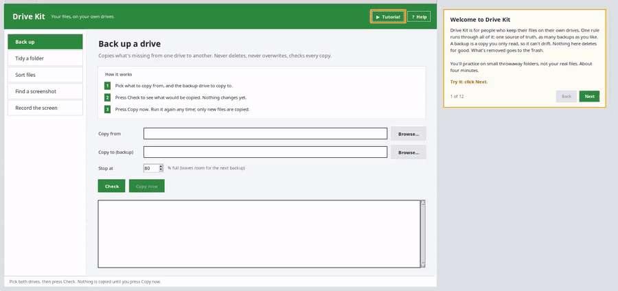
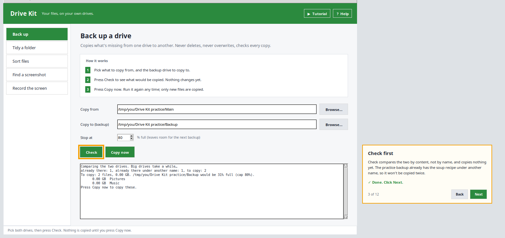
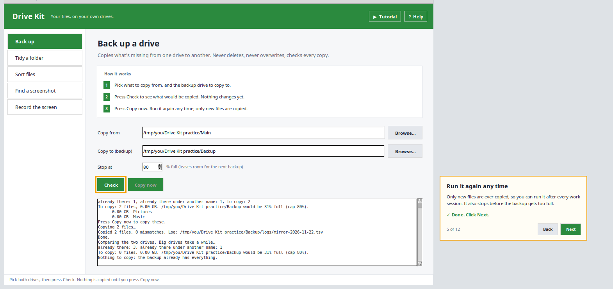
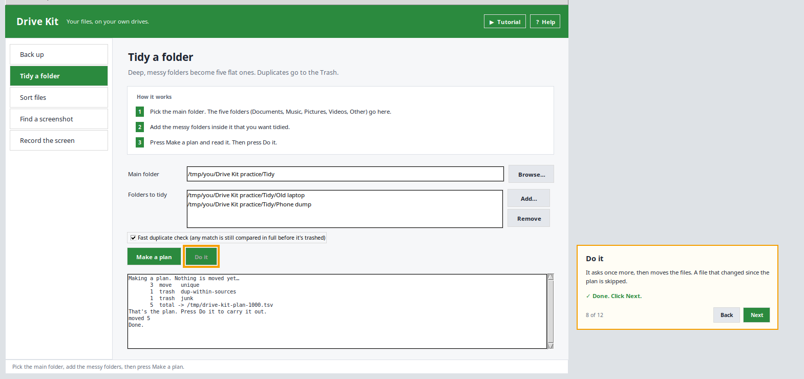

# Drive Kit

**Your files, on your own drives: backed up, tidy, sorted and searchable.**

Five tools in one window for people who keep their files on their own drives instead of renting space in someone else's cloud: back up a drive, tidy a messy folder, sort a pile of photos, find a screenshot by a word that was on it, and record the screen. Free, offline, no account.



*The first time you open it, a tutorial has you back up and tidy two small practice folders, so you learn on throwaway files, not your real ones. ([Full video](docs/tutorial.mp4))*

---

## Why this exists

Owning your files is cheaper and more private than a cloud subscription, and it's also more work. We kept running into the same problems with our own drives:

- **Two drives that were supposed to match didn't.** We edited files on both, and after a few months neither could be trusted. Fixing it meant comparing them file by file.
- **Copying to a drive that Windows and Mac can read failed.** Linux allows characters like `:` and `?` in file names, and exFAT and NTFS drives don't, so those files were quietly skipped.
- **Old laptops and phone dumps left folders inside folders inside folders,** often with the same photo in four places.
- **Thousands of photos and screenshots** that nobody would ever go through in a file manager.
- **The one screenshot you need** (an order number, an error message, an address) is impossible to find by file name.

Out of that came one rule, which runs through every tool here:

> **One source of truth, as many backups as you like.**

A backup is a copy you only read, so it can't drift away from the original. A second copy you keep editing will drift. So these tools copy toward the backup and never back. They never overwrite a file and never delete one for good: whatever they remove goes to the Trash, where you can restore it.

## What it can replace

Drive Kit is built to be a free alternative to these. Each is good at its job. Drive Kit makes different trade-offs.

| If you use… | It's good at… | What Drive Kit does differently |
|---|---|---|
| **Dropbox, Google Drive, iCloud** | Your files everywhere, automatically | Your files stay on drives you own, with no monthly fee. Sync services copy a deletion everywhere, by design. Here a backup is only ever added to, so deleting something on your main drive never deletes the backup. |
| **FreeFileSync** and other folder-sync tools | Fast, flexible sync with many modes | Mirror-style sync makes the backup match the source, and that includes deleting. **Back up** only adds. It matches by content, so a file you renamed or moved isn't copied twice, and it fixes names that exFAT or NTFS can't store. |
| **Time Machine** (Mac), **File History** (Windows) | Automatic versioned backups | Each works on one system and keeps its own format. **Back up** gives you plain files, readable on any computer, and works the same on Windows, Mac and Linux. |
| **dupeGuru** and other duplicate finders | Finding duplicates, including look-alike photos | They find duplicates but leave the mess of folders. **Tidy** finds exact duplicates *and* flattens the folders, keeping the old folder name in each file's name so you can always tell where it came from. |
| **Google Photos** text search | Finding a photo by the words in it | Search works after you upload your library. **Find a screenshot** reads the text on your own computer, and nothing leaves it. |

## The tools

| Tool | What it does | Runs on |
|---|---|---|
| **Back up** (`mirror.py`) | Copies whatever is missing from one drive to another. Compares by content, checks every copy and keeps a log. Stops before the backup drive gets too full. | Windows, Mac, Linux |
| **Tidy a folder** (`flatten.py`) | Turns a deep folder tree into five flat folders (Documents, Music, Pictures, Videos, Other) and moves exact duplicates to the Trash. Plans first, then applies. | Linux, Mac |
| **Sort files** (`sorter.py`) | Shows each file full-window. **K** keeps it, **D** sends it to the Trash, **U** undoes. Works with pictures, video, audio, PDFs and text. | Linux (GTK) |
| **Find a screenshot** (`shot_search.py`) | Reads the text in your screenshots once, so you can find one by a word that was on screen. | Windows, Mac, Linux |
| **Record the screen** (`record.sh`) | Records the screen or one window: hardware H.264 when your graphics card has it, the computer's sound included, and a file that survives a crash. | Linux (X11) |

## Download

Free, no account. Get the file for your computer from the [latest release](https://github.com/sebaytlabs/drive-kit/releases/latest):

| Your computer | File | Then |
|---|---|---|
| Windows 10 or 11 | `DriveKit-<version>-windows-setup.exe` | Run it. If Windows says *Windows protected your PC*, click **More info → Run anyway** (once). |
| Mac with Apple chip (M1 and later) | `DriveKit-<version>-mac-ARM64.dmg` | Open it and drag Drive Kit to Applications. The first time, macOS says it can't check the app: open **System Settings → Privacy & Security**, scroll down and click **Open Anyway** (once). |
| Mac with Intel chip | `DriveKit-<version>-mac-X64.dmg` | Same as above. |
| Linux | `DriveKit-<version>-x86_64.AppImage` | Make it runnable (right-click → Properties → *Allow executing*, or `chmod +x` it), then double-click it. |

The download includes the screenshot text reader. On Linux, **Sort files** uses your system's GTK (see [sorter.py](#sorterpy) for the one install line) and **Record the screen** uses ffmpeg.

The apps aren't signed with a paid developer certificate yet, which is why Windows and macOS ask once.

## Start

To run it from source instead, you need Python 3.9 or newer (on Linux also `python3-tk`).

```
git clone https://github.com/sebaytlabs/drive-kit
cd drive-kit
python3 drive_kit_app.py
```

The first time, a **tutorial** runs by itself. It makes a small `Drive Kit practice` folder in your home folder and walks you through it, one step and one real click at a time:
1. Check what a backup would copy, copy it, then check again and see there's nothing left to copy.
2. Plan a tidy of a messy practice folder, then do it.
3. See where Sort, Find and Record are.

It takes about four minutes. Delete the practice folder afterwards. The **▶ Tutorial** button runs the tutorial again, and **F1** explains any page.

**A typical week with it:**
- **After a work session:** plug in the backup drive, then Back up: **Check**, **Copy now**. Only new files are copied, so it's quick.
- **Once, for an old laptop:** Tidy a folder turns its 400 nested folders into five, with duplicates in the Trash.
- **An evening:** Sort files through last year's photos, K and D. It remembers where you stopped.

## Why it works the way it does

- **Compare by content, not by name.** People rename and move files. If a backup only compared names, every renamed file would be copied again and the backup would fill with duplicates. Back up hashes the files, so a renamed file is recognized.
- **Check every copy.** A copy can fail silently, from a loose cable or a dying drive. Each copied file's SHA-256 checksum is compared with the original's and written to a log on the backup, and any mismatch is flagged. (The operating system may answer that check from memory instead of the disk, so it catches a bad copy, not every bad disk. To check the disk itself, unplug and replug it, then compare the files with the `sha256` column in the log, for example with `sha256sum`.)
- **Never overwrite.** If the backup has a *different* file at the same path, the new one is saved as `name (from Main).ext`, or `(from Main 2)` and up if that name is taken too. Two versions are better than a silently lost one.
- **A copy is only named when it's whole.** Each file is copied under a temporary name (`.name.mirror-part`) and renamed once it's complete, so a copy cut short by a pulled cable never passes for a finished file. The next run copies it again.
- **Plan first, then act.** Tidy writes its whole plan before moving anything, and skips any file that changed since. You see exactly what will happen.
- **The Trash, not delete.** Every removal can be undone with your system's own Restore.
- **Keep where it came from.** A flattened file is named `<old folder>__<file>`, so `taxes__2024.pdf` still tells you its story.
- **Screenshots, not photos.** On a real library almost every screenshot had text and almost no camera photo did. Reading only PNGs by default skips hours of wasted work.
- **The sorter waits until you can see.** An early version sometimes kept showing the previous picture while the next one loaded, so a fast **D** could trash a file you hadn't seen. Now a key press only counts once the picture is on screen, holding **D** deletes one file, not twenty, and **U** undoes.

## The command line

Everything also works without the app.

### mirror.py

```
python3 mirror.py /media/me/Main /media/me/Backup               # dry run: what would be copied, and how full it gets
python3 mirror.py /media/me/Main /media/me/Backup --apply       # copy, check each copy (sha256), log to Backup/logs/
python3 mirror.py /media/me/Main /media/me/Backup --only Documents Pictures --cap 90
```

- **Skipped:** a file the backup already has at the same path and size, or with the same content under any name. Files you renamed or moved on the backup aren't copied again.
- **Never overwritten:** if the path holds a different file, the copy is saved as `name (from Main).ext` (then `(from Main 2)` and up). Names are compared without case, as exFAT and NTFS do, and two source files whose safe names match (`a:b.txt` and `a-b.txt`) each keep their own copy.
- **Safe names:** characters that exFAT and NTFS can't store (`: * ? " < > |`) become `-`, so a Linux drive can be mirrored to a drive Windows and Mac can read.
- **Space limit:** it stops before the destination passes `--cap` percent full (default 80). That leaves space for the next sync, and SSDs slow down when they're nearly full.
- **Both ways:** run it in each direction to keep two drives in step without ever deleting anything.

### flatten.py

```
python3 flatten.py plan  ~/Drive OldBackup "Phone dump"     # writes plan.tsv, moves nothing
python3 flatten.py apply                                     # carries out plan.tsv
```

- **Where files go:** each file is sorted by type into one of the five folders. Files that came from a subfolder are renamed `<old-folder>__<file>`, so you can always tell where something came from (`ls Documents | grep '^taxes__'`).
- **What goes to the Trash:** exact duplicates and system junk such as `.DS_Store`, `Thumbs.db` and `desktop.ini`. They land in one dated folder that keeps the original paths, so they're easy to restore.
- **What it leaves alone:** git repos and symlinks.
- **Safety check:** a file that changed after the plan was made is skipped.
- **Speed:** `--fast` hashes only the start and end of each file, then compares any match in full before trashing it.

### sorter.py

```
python3 sorter.py
```

Pick a folder, then go through it one file at a time. **K** moves the file to a `Kept` folder, **D** sends it to the Trash and **U** undoes the last one. **Space** plays video and **O** opens the file in its own app. It remembers where you stopped.

On Debian, Ubuntu or Mint, install the dependencies with `sudo apt install python3-gi gir1.2-gtk-3.0 gir1.2-gst-plugins-base-1.0 gstreamer1.0-plugins-good`.

### shot_search.py

```
pip install rapidocr_onnxruntime        # offline OCR, nothing else to install (or put tesseract on your PATH)
python3 shot_search.py index ~/Pictures/Screenshots
python3 shot_search.py find tracking number
```

- **PNG only by default.** On a real library almost every screenshot had text and almost no camera photo did, so this skips hours of wasted work. Add `--all-images` to read every image anyway.
- **Quick to re-run.** Only new or changed files are read again.

### record.sh

```
./record.sh                # click a window to record it
./record.sh --full         # the whole screen
./record.sh --no-audio --out ~/Recordings
```

- **Frame rate:** it records at your monitor's refresh rate, capped at 60.
- **Encoding:** it uses VAAPI hardware encoding when your graphics card supports it and falls back to x264 when it doesn't.
- **Stopping:** press **q** or **Ctrl-C**.

## Screenshots


*Back up: Check shows what would be copied, and copies nothing yet.*


*Run it again: only new files are ever copied.*


*Tidy: plan first, then do it. Duplicates and junk go to the Trash.*

## Related tools

- **[Clip Pipeline](https://github.com/sebaytlabs/clip-pipeline).** If you record videos, it turns recordings into clips. Drive Kit backs the recordings up.
- **[SimpleBrain](https://github.com/sebaytlabs/simplebrain).** A notes app that files the documents you drop on it next to the note they belong to.
- **[Transcribe Folder](https://github.com/sebaytlabs/transcribe-folder).** Make the audio and video on your drives searchable as text.

## Limits, plainly

- **Back up only adds.** It never deletes from the backup, so if you delete a file on purpose, delete it from the backup yourself too.
- **The first comparison of a big drive is slow,** because every file is read. After that only new files are read.
- **Sort and Record are Linux-only for now.** Tidy runs on Linux and Mac. Back up and Find a screenshot run everywhere.
- **Text reading (OCR) isn't perfect.** Small or stylized text can be missed. Search for a couple of distinctive words.

## Tests

```
python3 mirror.py --selftest
python3 flatten.py selftest
python3 shot_search.py --selftest
```

## License

MIT. Made by [Sebayt Labs](https://sebaytlabs.com). We build free tools when the usual ones are too expensive, too complicated, or don't do the job.
